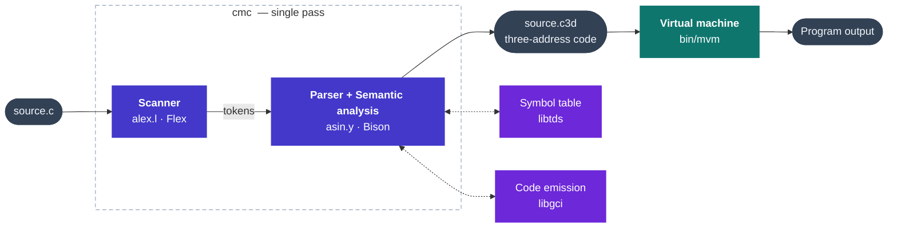

# C-- Compiler

A compiler for **C--**, a small statically-typed subset of C, built as a university compiler-construction project. It performs lexical, syntactic and semantic analysis and generates **three-address code (3AC)** that runs on a stack-based virtual machine.

The compiler is implemented in **C** using **Flex** (scanner) and **Bison** (parser), following the classic single-pass, syntax-directed translation approach: semantic checks and code generation happen inside the grammar actions while parsing.

> Academic project (2023–2024) developed by a team of 4 students.

---

## Compilation pipeline



1. **Lexical analysis** ([src/alex.l](src/alex.l)) – tokenizes the input: keywords, identifiers, integer constants, operators and delimiters.
2. **Syntactic & semantic analysis** ([src/asin.y](src/asin.y)) – an LALR grammar whose actions perform type checking, symbol-table management and three-address code generation in a single pass. Forward jumps (for `if` / `else` / `while`) are backpatched through *unsatisfied-argument lists* (LANS).
3. **Driver** ([src/principal.c](src/principal.c)) – command-line handling and error reporting. On success it dumps the generated code to a `.c3d` file.
4. **Execution** – the resulting `.c3d` file is interpreted by the `mvm` virtual machine.

---

## Language features

The C-- language supports:

- **Types:** `int`, `bool`, fixed-size arrays and `struct` records.
- **Functions** with parameters, local variables and a mandatory `return`, including recursion and a required `main` function.
- **Control flow:** `if` / `else` and `while`.
- **I/O:** `read(x)` and `print(expr)`.
- **Operators:**
  - Arithmetic: `+ - * /`, unary `+ -`, increment/decrement `++ --`.
  - Relational: `> >= < <=`, equality `== !=`.
  - Logical: `&& || !`, with constants `true` / `false`.
- **Comments:** line comments with `//`.
- **Semantic checks:** undeclared/duplicate identifiers, type compatibility, array-index typing, parameter-domain matching on calls, return-type checking, etc.

See the [examples/](examples/) directory for sample programs, including arithmetic, logical/relational expressions, functions with global and local scope, structs, and a Sieve of Eratosthenes ([examples/c09.c](examples/c09.c)).

---

## Repository structure

```
.
├── src/                # Compiler sources
│   ├── alex.l          #   Flex scanner
│   ├── asin.y          #   Bison grammar (parsing, semantics, code generation)
│   └── principal.c     #   Main driver and error handling
├── include/            # Shared headers
│   ├── header.h        #   Constants, attribute structs and globals
│   ├── libtds.h        #   Symbol-table API
│   └── libgci.h        #   Three-address-code generation API
├── lib/                # Precompiled support libraries (course material)
│   ├── libtds.a        #   Symbol-table implementation
│   └── libgci.a        #   Code-generation helpers
├── bin/
│   └── mvm             # Virtual machine that executes .c3d code
├── examples/           # Sample C-- programs and their generated .c3d output
├── Makefile
└── README.md
```

---

## Building

> The build uses `gcc`, `flex` and `bison` and targets **Linux** (the precompiled `lib/*.a` libraries and the `mvm` virtual machine are Linux x86-64 binaries).

```sh
make          # produces the `cmc` compiler executable
make clean    # removes generated files
```

## Usage

```sh
./cmc [-v] [-t] <source-file>
```

| Flag   | Meaning                                       |
| ------ | --------------------------------------------- |
| `-v` | Verbose: print a trace of the scanned tokens. |
| `-t` | Print the symbol table for each function.     |

A successful compilation writes the three-address code next to the input, with the `.c3d` extension. Run it on the virtual machine:

```sh
./cmc examples/c09.c        # generates examples/c09.c3d
bin/mvm examples/c09.c3d    # executes the generated code
```

---

## Notes

- `lib/libtds.a`, `lib/libgci.a` and `bin/mvm` were **provided as course material**. Their interfaces are documented in [include/libtds.h](include/libtds.h) and [include/libgci.h](include/libgci.h). The original work in this repository is the scanner, the grammar with its semantic actions and code generation, and the driver.
- Generated files (`alex.c`, `asin.c`, `include/asin.h`, object files and the `cmc` binary) are produced by `make` and are intentionally not tracked in version control.
